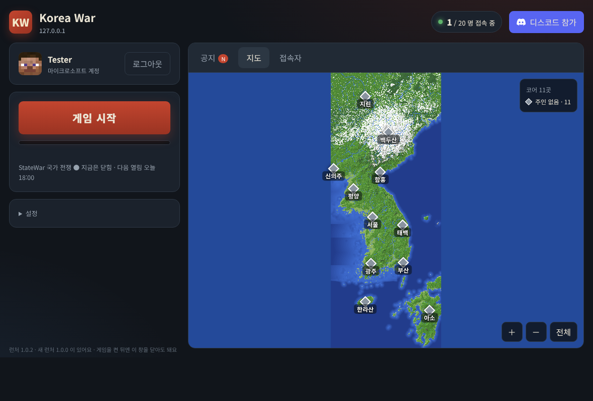

# Chegal Minecraft Launcher (KoreaWar Launcher)

A small, free, open-source **Minecraft: Java Edition** launcher for one private community server (*Korea War*, a nation-war server on a Korean-peninsula map).
Not affiliated with Mojang or Microsoft. No ads, no payments, no data collection.

## What it does
1. **Sign in with your own Microsoft account** — OAuth 2.0 authorization code flow with PKCE, personal Microsoft accounts only, loopback redirect `http://localhost:25585/auth`.
   Microsoft → Xbox Live → XSTS → `api.minecraftservices.com/authentication/login_with_xbox` → `minecraft/profile`.
   Tokens are stored **only on the player's own computer** and are sent only to Microsoft/Xbox/Minecraft services.
2. **Download the official, unmodified game** from Mojang's servers (`piston-meta.mojang.com`, `libraries.minecraft.net`, `resources.download.minecraft.net`, Mojang Java runtime), verified by SHA-1.
3. **Install Fabric Loader** (`meta.fabricmc.net`) and keep the server's open-source companion mod up to date (mod list + SHA-1 from the game server).
4. **Launch and auto-connect** to the community server (Quick Play multiplayer).

The game is launched only for players who own Minecraft: Java Edition. There is no offline/cracked mode.

## Network endpoints used
| Host | Purpose |
|---|---|
| login.microsoftonline.com | Microsoft sign-in (consumers) |
| user.auth.xboxlive.com, xsts.auth.xboxlive.com | Xbox Live / XSTS tokens |
| api.minecraftservices.com | Minecraft login + profile |
| piston-meta.mojang.com, piston-data.mojang.com, libraries.minecraft.net, resources.download.minecraft.net, launchermeta.mojang.com | Official game files and Java runtime |
| meta.fabricmc.net, maven.fabricmc.net | Fabric Loader |
| our game server (port 8163) | mod list and mod files |

## Build
Go 1.24+, standard library only: `./build.sh 1.0.0` (Windows / macOS / Linux, x64 and arm64).
The UI is a local web page served on `127.0.0.1:25585` and opened in the default browser.

---

## 한국어
Korea War 서버 전용 마인크래프트 자바 에디션 런처예요. 마이크로소프트 계정으로 로그인 → 공식 게임 파일·Fabric·보조 모드를 받고 업데이트 → 서버로 바로 접속해요.
게임을 산 계정만 쓸 수 있고, 로그인 정보는 내 컴퓨터에만 저장돼요. 무료·광고 없음·오픈 소스 (MIT).

## License
MIT
